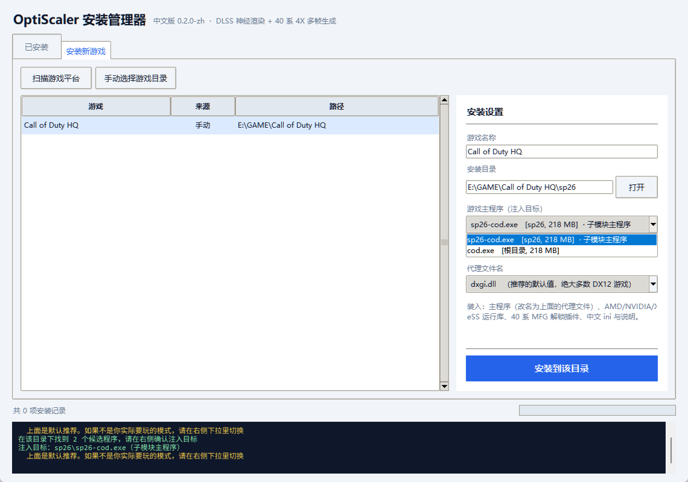

# OptiScaler Manager

给 [OptiScaler](https://github.com/optiscaler/OptiScaler) 用的图形化安装管理器，Windows 桌面程序（Python + tkinter）。

自动找游戏、帮你选对注入目标、一键装、无损卸，卸载时把被覆盖的原文件原样还回去。



## 为什么需要它

OptiScaler 是代理 DLL，**必须放在真正加载图形 API 的那个 exe 旁边**。但现实里：

- 游戏可能有好几层目录（赛博朋克在 `bin\x64`，虚幻引擎在 `Binaries\Win64`）
- 根目录那个 exe 可能只是启动器（Call of Duty HQ 的 `cod.exe`，真正跑游戏的是 `sp26\sp26-cod.exe`）
- 同一个目录里可能已经被别的注入器占了代理名（ReShade、旧版 OptiScaler）

装错地方不只是"没效果"，多个注入器叠加还会让游戏直接打不开。这个工具就是解决这些。

## 功能

- **扫描游戏**：Steam（注册表 + `libraryfolders.vdf`）、Epic（manifests）、GOG（注册表），一次扫完
- **识别注入目标**：列出目录下所有候选 exe 并排序，标注 `UE 主体` / `子模块` / `启动器` / `辅助程序`
  - 虚幻引擎优先 `*-Win64-Shipping.exe`
  - 子目录同名 exe 优先（`sp26\sp26-cod.exe` 这类内容包）
  - 自动过滤 EasyAntiCheat 启动器、崩溃上报、安装器等
- **无损安装**：目标已有同名文件先备份到 `.optiscaler_backup\`，安装清单记 SHA-256
- **无损卸载**：只按清单删，找不到清单直接拒绝；备份原样还原；只删空目录
- **已安装管理**：列表、状态、完整性校验、一键卸载、打开目录
- **装前冲突检测**：扫描目标目录里已有的代理 DLL 和 ReShade 痕迹，读 PE 版本信息区分系统文件与第三方注入器
  - 同目录已有别的注入器时先拦下来（两个注入器共存基本必炸）
- **附加处理**：装完后自动把游戏自带的 Streamline 复制进 `OptiScaler\streamline`（`FGOutput=DLSSG` 需要它）

## 快速开始

本仓库**不包含任何二进制文件**，payload 需要你自己准备（版权原因，见下方）。

### 1. 准备 payload

在仓库根目录建 `payload/`，按这个结构放：

```
payload/
├─ OptiScaler/                 # OptiScaler 原始包里的整个文件夹
│  ├─ amd_fidelityfx_*.dll
│  ├─ libxess*.dll
│  ├─ D3D12_OptiScaler/
│  └─ plugins/
│     └─ MFGUnlocker.asi       # 40 系多帧生成解锁器（可选）
├─ Licenses/
├─ OptiScaler.dll              # 汉化后的主程序（见下一步）
├─ OptiScaler.ini              # 用 docs/OptiScaler.ini.zh
├─ nvngx.dll_dlssnr.dll        # 原始包自带
└─ nvngx_dlssnr.dll            # 神经渲染模型，自备（约 158 MB）
```

具体来源：

| 文件 | 从哪来 |
|---|---|
| OptiScaler 全套 | OptiScaler 的 DLSSNR 构建（GitHub Releases） |
| `OptiScaler.ini` | 本仓库 `docs/OptiScaler.ini.zh`（已翻译） |
| `MFGUnlocker.asi` | [dashdogy/MFG-Unlocker](https://github.com/dashdogy/MFG-Unlocker) Releases，把 `.dll` 改名为 `.asi` |
| `nvngx_dlssnr.dll` | NVIDIA 驱动内的模型文件，需自备 |

### 2. 生成汉化主程序

本仓库带了一套汉化补丁（翻译表 + 二进制改写工具）：

```bash
python patch_ui.py <原始OptiScaler.dll> payload/OptiScaler.dll translations.json
```

> 原理：把中文串写进新增的 `.zh` 节，再改写代码里对原英文串的 RIP-relative 引用。
> 只动显示文本，不改逻辑。详见 [docs/菜单汉化说明.txt](docs/菜单汉化说明.txt)。

### 3. 构建

```bash
python -m venv .venv
.venv\Scripts\pip install pyinstaller
.venv\Scripts\pyinstaller --noconfirm --clean build.spec
```

产物在 `dist/OptiScalerManager/`（exe + `_internal`，必须整体分发）。

也可以不打包直接跑：

```bash
python main.py
```

### 4. 用

1. 「安装新游戏」→ 扫描或手动选目录
2. 在「游戏主程序（注入目标）」下拉里确认选对了 exe
3. 代理名保持 `dxgi.dll`（Vulkan 游戏用 `winmm.dll`）
4. 安装 → 进游戏按 `Insert` 打开菜单

卸载在「已安装」页，选一条点「卸载所选」。

## 已知限制

- **菜单顶部标签栏仍是英文**。这些字符串（`Upscaler`/`Menu`/`Log`/`Spoofing`…）和 ini 配置段名是同一份数据，改了会导致配置读不出来，所以没动。控件名、说明、下拉项都已汉化。
- **40 系的 DLSS 神经渲染**需要社区修改版的 `nvngx_dlssnr.dll`。NVIDIA 原版模型只能在 RTX 50 上初始化。
- **反作弊游戏不要用**。注入型工具会被检测，联机游戏有封号风险。
- 一个游戏目录里**只能有一个注入器**。管理器会在安装前检测并列出冲突，但最终仍由你决定是否继续——
  强烈建议先把旧的改名成 `.disabled` 再装。

## 测试

```bash
python test_core.py    # 安装/备份/校验/卸载/重复卸载
python test_model.py   # 玩家自备模型文件不被覆盖、卸载不删
python test_conflict.py # 已有注入器识别（含系统 DLL 不误报）
```

## 仓库里为什么不带二进制

`payload/` 里的 AMD FidelityFX、NVIDIA NGX/Streamline、XeSS 运行库以及 `nvngx_dlssnr.dll` 都不是本项目的产物，多数不允许再分发。请自行从对应官方渠道获取。

`.gitignore` 已忽略 `payload/` 下的所有内容，只保留说明文件。

## 致谢

这个工具本身只是安装器，真正干活的是别人的成果：

- **[OptiScaler](https://github.com/optiscaler/OptiScaler)** — nitec 及所有贡献者。
  超分接管、帧生成、伪装这一整套能力都来自它，本工具安装的就是它。
- **OptiScaler DLSSNR 分支** — dag。把 DLSS 5 神经渲染做成 OptiScaler 的一个额外 pass。
- **[MFG-Unlocker](https://github.com/dashdogy/MFG-Unlocker)** — dashdogy。
  让 40 系也能用多帧生成，MIT 许可。
- **[RenoDX](https://github.com/clshortfuse/renodx)** — clshortfuse。
  神经渲染的色彩合成方式取自这里，见 `Licenses/RenoDX_ATTRIBUTION.txt`。
- **中文菜单** — 本项目维护的 776 条翻译与二进制改写工具。

如果你觉得这套东西好用，功劳是他们的。

## 许可

本项目代码以 MIT 许可发布，见 [LICENSE](LICENSE)。

随安装包分发的 OptiScaler 相关文件遵循各自的许可（见 `Licenses/`）。
**不包含** NVIDIA 的 `nvngx_dlssnr.dll`（神经渲染模型），该文件需自行准备。

本项目与 NVIDIA、AMD、Intel 无关联。

## 免责声明

仅供单机游戏的技术研究。使用前请备份，风险自负。请勿用于在线游戏或违反游戏服务条款的场景。
